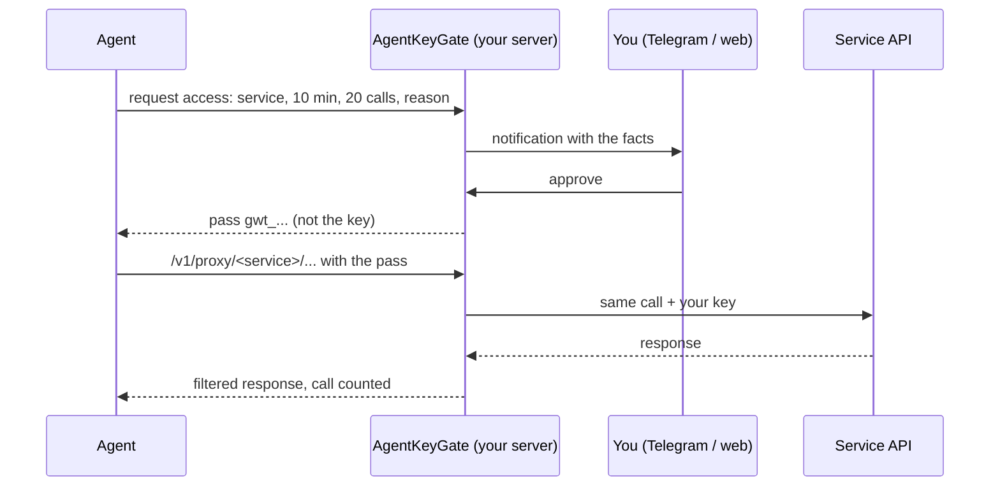

<h1 align="center">AgentKeyGate</h1>

<p align="center"><b>Give your agent a pass for 20 calls and 10 minutes.</b><br>Your AI agent shouldn't know your API keys.</p>

<p align="center">


</p>

<p align="center"><a href="#quick-start">Quick start</a> · <a href="#connect-your-agent-mcp">MCP</a> · <a href="#use-it-as-a-skill">Skill</a> · <a href="#faq">FAQ</a> · <a href="https://agentkeygate.com">agentkeygate.com</a> · <a href="README.ru.md">Русский</a></p>

**AgentKeyGate is a free, self-hosted gateway that gives AI agents short-lived, owner-approved passes to APIs instead of the API keys.** The agent asks for access and says why. You approve it in Telegram or on the web. The gateway adds your key to each call, counts the calls, filters what comes back, and closes the pass when the time or the calls run out. The agent never sees the key.

It is for people who run Claude Code, Codex, Cursor, Hermes, OpenClaw or their own scripts against a real CRM, payment, email or LLM account and do not want a long-lived key in every agent's config.


## What you get

- **The key stays on your server.** Keys are encrypted at rest, in AWS SSM Parameter Store or an encrypted file vault. Agents get passes (`gwt_...`), never keys. Key values never appear in logs, URLs, responses or errors.
- **A pass is limited by time and by calls.** Each pass has a TTL, a maximum number of calls and a parallelism limit. There is also a per-agent rate limit.
- **You approve with the facts in front of you.** The request shows the agent, the service, the time, the number of calls and the agent's reason. Approve in Telegram or on the web; Slack and e-mail can notify you.
- **You decide what comes back from your CRM.** CRM and support keys are read-only by default. You pick data types and fields, the gateway cuts the rest from the response and can mask e-mails, phone numbers, card numbers and IBANs.
- **One kill switch.** Revoke a pass, an agent or everything at once. It takes effect on the next call.
- **An audit log.** Requests, approvals, calls, blocked calls and logins go to an append-only log. The Activity page counts every call, including the ones the filter blocked.

## How does it work?



1. An agent needs an API, for example Bitrix24. It asks the gateway for access with a TTL, a call limit and a reason: "Weekly report: leads that changed status since Monday".
2. You get a notification in Telegram, Slack or e-mail. You approve in Telegram or on the web, or a standing policy approves it.
3. The agent receives a pass. It calls `/v1/proxy/bitrix24/...` with it. The gateway adds your key, forwards the call and counts it.
4. After 20 calls or 10 minutes (the numbers are an example) the pass stops working.

## Quick start

### VPS (Debian 12, Ubuntu 24.04)

Point a DNS A record at the server, then run:

```bash
curl -fsSL https://raw.githubusercontent.com/maximskorohod/agentkeygate/v1.0.2/scripts/setup.sh -o setup.sh
echo "e0ddced59b9c360681161e300232726c32b49fb5f39ee8686765b2971faec2fc  setup.sh" | sha256sum -c -
sudo bash setup.sh --domain gw.example.com
```

The default vault is AWS SSM, which needs an instance role. Outside AWS, add `--vault file`.

The script installs Node.js 22, Caddy (automatic TLS) and systemd services, and prints a one-time setup link (valid 15 minutes). Open it to set the owner password, turn on 2FA and connect Telegram or Slack. Backups and restore: [docs/DEPLOY.md](docs/DEPLOY.md).

### On your machine (npm)

Requires Node.js 22.

```bash
npm ci
GW_VAULT=file node bin/gateway.js init     # prints the one-time setup link
node bin/gateway.js start                  # http://127.0.0.1:8080
npm test
```

After the setup wizard the site opens `/welcome` with a card for each agent client below. A Docker setup is described in [docs/DEPLOY.md](docs/DEPLOY.md); it has not been tested with a real certificate.

## Connect your agent (MCP)

Create an agent in the web UI (Agents). The agent token (`gwa_...`) is shown once. Each card on `/welcome` creates the agent and prints the snippet for that client. Snippets keep the token out of the config where the client supports environment variables (`AGENTKEYGATE_TOKEN`) or a hidden input.

| Agent | Where the config goes | Transport | Checked live |
| --- | --- | --- | --- |
| Claude Code | terminal: a `claude mcp add` command | Streamable HTTP | no |
| Codex | `~/.codex/config.toml` | Streamable HTTP | no |
| Cursor | `~/.cursor/mcp.json` (global) or `.cursor/mcp.json` (project) | Streamable HTTP | no |
| VS Code | `.vscode/mcp.json` in the workspace | Streamable HTTP | no |
| Gemini CLI | `~/.gemini/settings.json` | Streamable HTTP | no |
| Hermes | the agent's YAML config, `mcp_servers` | Streamable HTTP | no |
| OpenClaw | the agent's JSON config, `mcp.servers` | Streamable HTTP | no |
| Claude Desktop | `claude_desktop_config.json`, via `mcp-remote` (native header support in the app is a closed beta) | stdio through mcp-remote | no |
| ChatGPT | an Actions schema on a custom GPT; MCP needs OAuth, which the gateway does not offer yet | REST (Actions schema) | no |

`Checked live` says whether the snippet has been verified against the running client. `no` means it follows the client's documentation and has not been verified yet.

Example for Claude Code:

```bash
claude mcp add --transport http agentkeygate https://gw.example.com/mcp \
  --header "Authorization: Bearer $AGENTKEYGATE_TOKEN"
```

The MCP endpoint is listed in the [Official MCP Registry](https://registry.modelcontextprotocol.io) format in [server.json](server.json): `https://{host}/mcp` with a bearer token, where `{host}` is your own gateway.

## Use it as a skill

Agents that load [Agent Skills](https://agentskills.io) can use [skills/agentkeygate](skills/agentkeygate/SKILL.md) instead of MCP. The helper script `gw.sh` needs `curl` and `jq`. It reads `AGENTKEYGATE_URL` and `AGENTKEYGATE_TOKEN` from the environment.

| Client | Install |
| --- | --- |
| Most clients (skills.sh) | `npx skills add maximskorohod/agentkeygate` |
| Claude Code plugin | `claude plugin marketplace add maximskorohod/agentkeygate`, then `claude plugin install agentkeygate@agentkeygate` |
| Manual | copy `skills/agentkeygate` into the client's skills folder, see [skills/agentkeygate/README.md](skills/agentkeygate/README.md) |

## Services

In the catalog (`providers.yaml`): OpenAI, Anthropic, Google Gemini, OpenRouter, Groq, Mistral, GitHub, Slack, Notion, Linear, Stripe, HubSpot, Pipedrive, Zendesk, Atlassian (Jira and Confluence Cloud), Airtable, Resend, SendGrid, Twilio, Deepgram, ElevenLabs, Telegram Bot API, Bitrix24 (cloud and self-hosted), amoCRM, and Other: any public HTTPS API that takes a key in a header you name.

## Data filter

For services that support it, the owner limits what an agent sees. The filter works on the response, so it applies to every agent that uses the key.

- **Data types and fields.** Pick types (for example Deals) and fields inside them. Everything else is cut from the JSON answer before it reaches the agent. Methods and routes outside the chosen types return `403`.
- **Read only (`readOnly`).** Only reads pass. For REST services that means `GET` and `HEAD`, plus listed search routes. For Bitrix24 and Telegram it means a list of read methods. Writes return `403 write_not_allowed` and do not use up the quota. On by default for CRM and support keys (HubSpot, Pipedrive, Zendesk, Bitrix24, amoCRM).
- **Mask (`mask`).** Replaces e-mail addresses, phone numbers with `+` or separators, bank card numbers (Luhn check) and IBANs in all string values of a JSON answer with `****`. Names are not detected. A bare string of digits without `+` or separators is not masked, because it looks the same as an ID or an amount.
- **Weakening needs fresh 2FA.** Turning off `readOnly` or `mask`, adding a type, a field or a flag asks for a new TOTP code, then shows a "was, now" page before the change applies.
- **REST routes.** For REST services a rule is an HTTP method plus a route, such as `GET /crm/v3/objects/deals/:id`. Search is a separate flag per type. Batch and export routes stay closed.
- **Check on one call.** On the key's filter page, "Check on one call" makes one real read request as the owner (outside the agents' limits, written to the audit log) and shows field names only, never values.
- **What the agent knows.** The approval answer and the requests list carry a `filter` object (types, open methods, `read_only`, `mask`), so the agent can plan its calls.

Filters exist for Bitrix24, HubSpot, Pipedrive and Zendesk. The HubSpot and Pipedrive fields have been checked against live accounts. The Zendesk fields come from the provider's documentation (marked `unverified` in `providers.yaml`). Run "Check on one call" after you save.

Example, Bitrix24 `crm.lead.list` with a field filter:

```jsonc
// the service returns
{ "ID": "4182", "TITLE": "Anna Lee, website redesign", "STATUS_ID": "IN_PROCESS", "OPPORTUNITY": "12400.00",
  "NAME": "Anna", "PHONE": [{ "VALUE": "+1 415 555 0134" }], "COMMENTS": "Asked for a discount" }
// the agent gets
{ "ID": "4182", "STATUS_ID": "IN_PROCESS", "OPPORTUNITY": "12400.00" }
```

## How is it different?

Other projects also keep keys away from agents. This is what each one says on its own pages, checked on 7 November 2026. "Not described" means we did not find it there.

| | AgentKeyGate | OneCLI | TAP | Infisical Agent Vault |
| --- | --- | --- | --- | --- |
| License | Apache-2.0 | Apache-2.0, `ee/` under a separate license | Apache-2.0 | MIT core, some features paid |
| Self-hosted | yes | yes, also a cloud | yes, also hosted | yes, also a cloud |
| Owner approves a request | each request, in Telegram or on the web | yes, in chat | yes: dashboard, Telegram, Matrix, passkey | rules set in advance |
| Pass limited by number of calls | yes, plus time | not described | not described | time-bound sessions |
| Response field filter and masking | yes, for CRM and some other services | not described | removes the token from responses | not described |
| Price | free | free tier and paid plans | not listed | priced separately |

Compared with a key in `.env`: the agent can read the file, a prompt injection can ask it to send the key elsewhere, and the key keeps its full rights for as long as it lives.

## API reference

<details>
<summary>REST: request a pass, poll, call through the proxy</summary>

Request access. `ttl` is in seconds (300 to 86400, capped by the key's limit). `reason` is up to 200 characters and is shown to the owner.

```bash
curl -s -X POST https://gw.example.com/v1/grants \
  -H "Authorization: Bearer $AGENT_TOKEN" -H "Content-Type: application/json" \
  -d '{"provider":"gemini","ttl":600,"calls":20,"reason":"Summarize the 14 support tickets from today"}'
```

- `200` `{"status":"approved","token":"gwt_...","expires_at":...,"max_calls":20}`: approved immediately (the key's policy allows it).
- `202` `{"status":"pending","request_id":"...","poll_after":5}`: waiting for the owner.
- `403`: denied by policy, or no key for this service.

Poll while pending, no more often than every 5 seconds. The pass is issued once.

```bash
curl -s https://gw.example.com/v1/grants/$REQUEST_ID \
  -H "Authorization: Bearer $AGENT_TOKEN"
```

Call the service through the proxy. The path after `/v1/proxy/<service>/` is forwarded as is. The agent's own `Authorization` header is replaced by the gateway.

```bash
curl -s https://gw.example.com/v1/proxy/gemini/v1beta/models \
  -H "Authorization: Bearer $GRANT_TOKEN"
```

| Status | Code | Meaning |
| --- | --- | --- |
| 401 | `invalid_grant` | Pass invalid, expired, or revoked. |
| 403 | `method_not_allowed`, `write_not_allowed` | The owner's filter closed this method, or writes. |
| 400 | `query_not_allowed` | The query has a parameter the filter closes. |
| 429 | `quota_exceeded`, `rate_limited` | Call, parallelism, or rate limit reached. |
| 502 | `upstream_unreachable` | The service did not respond. |
| 503 | `service_unavailable` | Database or vault unavailable. The gateway fails closed. |

</details>

<details>
<summary>MCP endpoint</summary>

A Streamable HTTP endpoint at `/mcp`. Authenticate every request with `Authorization: Bearer gwa_...` (the agent token). Passes stay on the server, the model never sees them. Browser-based MCP clients need their origin in `GW_MCP_ORIGINS` (comma separated). Clients without an `Origin` header (CLI, desktop) work as is. `GW_MCP_ENABLED=0` turns the endpoint off. Tool reference: [docs/ARCHITECTURE.md](docs/ARCHITECTURE.md#mcp-tool-reference).

</details>

<details>
<summary>Configuration (environment variables)</summary>

Defaults are in `src/config.js`.

| Variable | Default | Meaning |
| --- | --- | --- |
| `GW_DATA_DIR` | `./data` | Directory for the SQLite database, file vault, and master key. |
| `GW_PORT` | `8080` | Listen port. |
| `GW_HOST` | `127.0.0.1` | Listen address. |
| `GW_PUBLIC_URL` | `http://127.0.0.1:8080` | Public base URL, used in links. |
| `GW_VAULT` | `file` | Key storage: `file` or `ssm`. |
| `GW_VAULT_PREFIX` | `/gateway` | Parameter path prefix for the SSM vault. |
| `GW_SSM_REGION` | `AWS_REGION`, then `eu-central-1` | AWS region for the SSM vault. |
| `GW_LOG_LEVEL` | `info` | Log level. |
| `GW_LANG` | `en` | Interface language: `en` or `ru`. |
| `GW_TZ` | `UTC` | Time zone for policy time windows and dates. |
| `GW_TRUST_PROXY` | `loopback` | Trusted reverse proxy addresses (comma separated). |
| `GW_PROXY_RATE_PER_MIN` | `300` | Proxy calls per agent per minute, for REST and MCP together. |
| `GW_MCP_ENABLED` | on | `0`, `false`, or `off` turns the `/mcp` endpoint off. |
| `GW_MCP_ORIGINS` | empty | Allowed browser origins for MCP (comma separated). |
| `GW_MCP_MAX_SESSIONS_PER_AGENT` | `5` | MCP sessions per agent. |
| `GW_MCP_MAX_SESSIONS` | `200` | MCP sessions in total. |
| `GW_MCP_IDLE_SEC` | `900` | Close an MCP session after this idle time. |
| `GW_MCP_MAX_LIFETIME_SEC` | `86400` | Maximum lifetime of an MCP session. |
| `GW_MCP_MAX_RESPONSE` | `65536` | Bytes of a service answer passed to the model. |
| `GW_MCP_BODY_LIMIT` | `262144` | Maximum size of an MCP request body, bytes. |
| `GW_MCP_CALL_PARALLEL` | `4` | Simultaneous `call`s per MCP session. |
| `GW_AUTH_PROVIDER` | local | Login module. An unknown name stops the start. See [docs/AUTH.md](docs/AUTH.md). |
| `GW_WAITLIST_URL` | empty | HTTPS link shown in the page footer. Anything else is ignored. |
| `GW_DEMO` | off | `1`, `true`, or `on` starts demo mode. |
| `GW_DEMO_RESET_SEC` | `3600` | Demo reset period. |
| `GW_PROD_HOSTS` | empty | Hostnames of a production gateway. A safety check for demo mode. |

</details>

<details>
<summary>Demo mode</summary>

`GW_DEMO=1` starts a shared public instance with no real data and no outgoing connections. It exposes one fake service (Demo CRM) answered by a mock inside the process, a fixed demo agent, a "Simulate agent request" button and a read-only showcase of all services, agent cards and settings. The data resets every hour (`GW_DEMO_RESET_SEC`). The process refuses to start if the data directory holds real data, and a second guard rejects any outgoing socket. Server-level isolation: [docs/DEPLOY.md](docs/DEPLOY.md).

</details>

## FAQ

### Is AgentKeyGate free?
Yes. It is open source under Apache-2.0 and runs on your own server. There is no paid tier and no cloud version.

### Do I need AWS?
No. Outside AWS use the encrypted file vault (`--vault file` or `GW_VAULT=file`). AWS SSM Parameter Store is an option when the gateway runs on an AWS instance with a role.

### What happens when the agent runs out of calls or time?
The next call returns `401 invalid_grant` or `429 quota_exceeded`. The agent has to ask for a new pass, and you see the new request with its reason.

### Can I use it without Telegram?
Yes. You can approve on the web UI. Slack and e-mail can send notifications; approval itself happens in Telegram or on the web.

### What does the model see from my CRM?
Only what the filter lets through: the data types and fields you ticked, read-only by default, with masking if you turn it on. Before you approve, the request shows an "Agent will see" line.

### Does it work with ChatGPT and Claude Desktop?
ChatGPT works through an Actions schema on a custom GPT; its MCP connectors need OAuth, which the gateway does not offer yet. Claude Desktop works through `mcp-remote`. Both are marked as not checked live.

### Does it stop a prompt injection?
It limits the damage. An injected instruction cannot read the key, because the agent never has it. Inside an approved pass the agent can still make any call the filter allows, so give each key the narrowest scope the service offers.

## Limitations

The gateway reduces what an agent can do with a key. It does not remove the trust in the server, the service, or the approval channel.

- Anyone with root on the server, or administrator access to the AWS account, can read all keys.
- Without a data filter, an approved pass allows any call the key allows. Use keys with the narrowest scope the provider offers.
- The service itself sees the key and the request data.
- An agent can search by a hidden field and learn from the result count whether a value exists.
- Masking has no ML and does not find names or bare digit strings.
- If someone takes over your Telegram or e-mail, they can approve requests.
- Zendesk stopped issuing new API tokens on 27 October 2026; existing tokens work until 30 April 2027. The Zendesk card suits existing tokens only and has not been tested on a live account.
- None of the agent snippets has been checked against a live client yet.
- Single owner. The code has not had an external security audit.

Full threat model and how to report a vulnerability: [SECURITY.md](SECURITY.md).

<details>
<summary>What has been tested</summary>

On a live server (Ubuntu 24.04, `file` vault, behind Cloudflare): install with `setup.sh`, the setup wizard and backup codes, requests and approvals over REST and MCP, keys for HubSpot, Pipedrive, Stripe and Twilio, read-only mode and data filters on real responses, the Slack test message, a backup and a full restore into a separate directory.

On a local install, not yet on a server: Telegram linking and the approval button, SMTP notifications through Resend, Atlassian (read works, write is rejected), the Airtable connection (reading records not checked).

Not tested: the `ssm` vault on AWS, Docker with a real Caddy certificate, certificate renewal behind Cloudflare, macOS, Safari. Reports are welcome.

Requirements: Node.js 22, 1 vCPU and 1 GB RAM for a single owner, SQLite (no external database). English is the default interface language, `GW_LANG=ru` switches to Russian.

</details>

## Roadmap

- Check every agent snippet against the live client
- A public demo instance
- OAuth, so ChatGPT and claude.ai connectors can use the MCP endpoint
- Several owners with separate policies

## Want this set up for your CRM?

I set up AI agents for Bitrix24, amoCRM and other CRMs on your own server, with the keys behind this gateway. Work is done in writing: a short brief, a written plan, updates as it goes. Write to skorohod@agentkeygate.com.

## License

Apache-2.0, free for any use. See [LICENSE](LICENSE). Contributing: [CONTRIBUTING.md](CONTRIBUTING.md). Security: [SECURITY.md](SECURITY.md).

Made by Maxim Skorohod · [agentkeygate.com](https://agentkeygate.com) · [GitHub](https://github.com/maximskorohod) · Updated 2026-11
