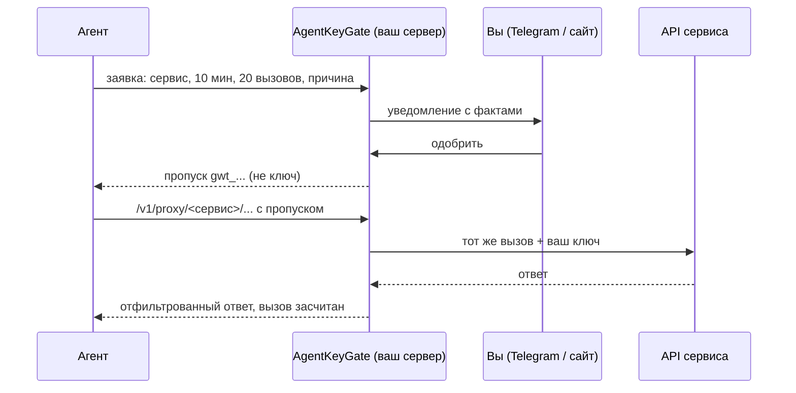

<h1 align="center">AgentKeyGate</h1>

<p align="center"><b>Пропуск для агента на 20 вызовов и 10 минут.</b><br>ИИ-агенту не нужно знать ваши API-ключи.</p>

<p align="center">


</p>

<p align="center"><a href="#быстрый-старт">Быстрый старт</a> · <a href="#подключение-агента-mcp">MCP</a> · <a href="#навык-skill">Навык</a> · <a href="#вопросы-и-ответы">Вопросы</a> · <a href="https://agentkeygate.com/ru/">agentkeygate.com</a> · <a href="README.md">English</a></p>

**AgentKeyGate это бесплатный шлюз на вашем сервере, который выдаёт ИИ-агентам временные пропуски к API вместо самих ключей.** Агент просит доступ и пишет, зачем он ему. Вы одобряете в Telegram или на сайте. Шлюз сам подставляет ключ в каждый вызов, считает вызовы, фильтрует ответ и закрывает пропуск, когда кончилось время или вызовы. Ключа агент не видит.

Для тех, кто пускает Claude Code, Codex, Cursor, Hermes, OpenClaw или свои скрипты в настоящую CRM, платёжку, почту или LLM-аккаунт и не хочет держать долгоживущий ключ в конфиге каждого агента.


## Что это даёт

- **Ключ остаётся на вашем сервере.** Ключи хранятся зашифрованными, в AWS SSM Parameter Store или в зашифрованном файле. Агент получает пропуск (`gwt_...`), а не ключ. Значения ключей не попадают в логи, адреса, ответы и тексты ошибок.
- **Пропуск ограничен временем и числом вызовов.** У каждого пропуска есть срок, максимум вызовов и лимит параллельных запросов. Плюс общий лимит частоты на агента.
- **Вы решаете, видя факты.** В заявке видно агента, сервис, срок, число вызовов и причину, которую написал агент. Одобрить можно в Telegram или на сайте, Slack и почта присылают уведомления.
- **Вы решаете, что агент увидит в CRM.** Ключи CRM и поддержки по умолчанию только на чтение. Вы отмечаете типы данных и поля, остальное шлюз вырезает из ответа, а e-mail, телефоны, номера карт и IBAN может закрыть звёздочками.
- **Одна кнопка «стоп».** Отзовите пропуск, агента или всё сразу. Действует со следующего вызова.
- **Журнал.** Заявки, решения, вызовы, заблокированные вызовы и входы пишутся в журнал, который нельзя править. Страница «Активность» считает каждый вызов, включая закрытые фильтром.

## Как это работает?



1. Агенту нужен API, например Bitrix24. Он просит у шлюза доступ: срок, число вызовов и причину, например «Недельный отчёт: лиды, сменившие статус с понедельника».
2. Вам приходит уведомление в Telegram, Slack или на почту. Вы одобряете в Telegram или на сайте, либо заявку одобряет заранее заданное правило.
3. Агент получает пропуск и вызывает с ним `/v1/proxy/bitrix24/...`. Шлюз подставляет ваш ключ, передаёт вызов и считает его.
4. Через 20 вызовов или 10 минут (числа для примера) пропуск перестаёт работать.

## Быстрый старт

### VPS (Debian 12, Ubuntu 24.04)

Направьте DNS-запись A на сервер и выполните:

```bash
curl -fsSL https://raw.githubusercontent.com/maximskorohod/agentkeygate/v1.0.2/scripts/setup.sh -o setup.sh
echo "e0ddced59b9c360681161e300232726c32b49fb5f39ee8686765b2971faec2fc  setup.sh" | sha256sum -c -
sudo bash setup.sh --domain gw.example.com
```

По умолчанию ключи хранятся в AWS SSM, для этого нужна роль инстанса. Вне AWS добавьте `--vault file`.

Скрипт ставит Node.js 22, Caddy (сертификат автоматически) и службы systemd, затем печатает одноразовую ссылку на настройку (живёт 15 минут). По ней вы задаёте пароль владельца, включаете 2FA и подключаете Telegram или Slack. Бэкапы и восстановление: [docs/ru/DEPLOY.md](docs/ru/DEPLOY.md).

### На своём компьютере (npm)

Нужен Node.js 22.

```bash
npm ci
GW_VAULT=file node bin/gateway.js init     # печатает одноразовую ссылку на настройку
node bin/gateway.js start                  # http://127.0.0.1:8080
npm test
```

После мастера настройки откроется `/welcome` с карточкой для каждого агента из таблицы ниже. Запуск в Docker описан в [docs/ru/DEPLOY.md](docs/ru/DEPLOY.md), с настоящим сертификатом его не проверяли.

## Подключение агента (MCP)

Создайте агента на сайте (раздел «Агенты»). Токен агента (`gwa_...`) показывается один раз. Каждая карточка на `/welcome` создаёт агента и печатает готовый фрагмент конфига для своего клиента. Где клиент умеет переменные окружения (`AGENTKEYGATE_TOKEN`) или скрытый ввод, токена в конфиге нет.

| Агент | Куда идёт конфиг | Транспорт | Проверено вживую |
| --- | --- | --- | --- |
| Claude Code | команда `claude mcp add` в терминале | Streamable HTTP | нет |
| Codex | `~/.codex/config.toml` | Streamable HTTP | нет |
| Cursor | `~/.cursor/mcp.json` (общий) или `.cursor/mcp.json` (проект) | Streamable HTTP | нет |
| VS Code | `.vscode/mcp.json` в рабочей папке | Streamable HTTP | нет |
| Gemini CLI | `~/.gemini/settings.json` | Streamable HTTP | нет |
| Hermes | YAML-конфиг агента, `mcp_servers` | Streamable HTTP | нет |
| OpenClaw | JSON-конфиг агента, `mcp.servers` | Streamable HTTP | нет |
| Claude Desktop | `claude_desktop_config.json` через `mcp-remote` (заголовки в самом приложении в закрытой бете) | stdio через mcp-remote | нет |
| ChatGPT | схема Actions в своём GPT; для MCP нужен OAuth, которого у шлюза пока нет | REST (схема Actions) | нет |

«Нет» в последней колонке значит: фрагмент собран по документации клиента, на живом клиенте его ещё не проверяли.

Пример для Claude Code:

```bash
claude mcp add --transport http agentkeygate https://gw.example.com/mcp \
  --header "Authorization: Bearer $AGENTKEYGATE_TOKEN"
```

Описание MCP-сервера для [Official MCP Registry](https://registry.modelcontextprotocol.io) лежит в [server.json](server.json): `https://{host}/mcp` с токеном, где `{host}` это адрес вашего шлюза.

## Навык (skill)

Агенты, которые загружают [Agent Skills](https://agentskills.io), могут работать через [skills/agentkeygate](skills/agentkeygate/SKILL.md) вместо MCP. Скрипту-помощнику `gw.sh` нужны `curl` и `jq`, адрес и токен он берёт из `AGENTKEYGATE_URL` и `AGENTKEYGATE_TOKEN`.

| Клиент | Установка |
| --- | --- |
| Большинство клиентов (skills.sh) | `npx skills add maximskorohod/agentkeygate` |
| Плагин Claude Code | `claude plugin marketplace add maximskorohod/agentkeygate`, затем `claude plugin install agentkeygate@agentkeygate` |
| Вручную | скопировать `skills/agentkeygate` в папку навыков клиента, см. [skills/agentkeygate/README.md](skills/agentkeygate/README.md) |
| Tap Hermes, только MCP | `hermes skills tap add maximskorohod/agentkeygate`, затем установить [skills/agentkeygate-mcp](skills/agentkeygate-mcp/SKILL.md): без скриптов и переменных окружения, агент работает через MCP-сервер |

## Сервисы

В каталоге (`providers.yaml`): OpenAI, Anthropic, Google Gemini, OpenRouter, Groq, Mistral, GitHub, Slack, Notion, Linear, Stripe, HubSpot, Pipedrive, Zendesk, Atlassian (Jira и Confluence Cloud), Airtable, Resend, SendGrid, Twilio, Deepgram, ElevenLabs, Telegram Bot API, Bitrix24 (облако и коробка), amoCRM и «Другой»: любой публичный HTTPS API, который принимает ключ в заголовке.

## Фильтр данных

Для части сервисов владелец ограничивает, что видит агент. Фильтр работает по ответу, поэтому действует на всех агентов, которые пользуются ключом.

- **Типы данных и поля.** Вы отмечаете типы (например, «Сделки») и поля внутри них. Всё остальное вырезается из JSON до того, как ответ дойдёт до агента. Методы вне отмеченных типов дают `403`.
- **Только чтение (`readOnly`).** Проходят только чтения: для REST это `GET`, `HEAD` и перечисленные маршруты поиска, для Bitrix24 и Telegram это список методов чтения. Запись даёт `403 write_not_allowed` и не тратит лимит. Включено по умолчанию для CRM и поддержки (HubSpot, Pipedrive, Zendesk, Bitrix24, amoCRM).
- **Маска (`mask`).** Заменяет на `****` e-mail, телефоны с `+` или разделителями, номера карт (проверка Луна) и IBAN во всех строках ответа. Имена не распознаются. Голая строка цифр без `+` и разделителей не закрывается: её не отличить от ID или суммы.
- **Ослабить правило можно только со свежим кодом 2FA.** Снять `readOnly` или маску, добавить тип, поле или флаг: нужен новый код, а перед применением сайт показывает «было → стало».
- **Маршруты REST.** Правило состоит из метода и маршрута, например `GET /crm/v3/objects/deals/:id`. Поиск включается отдельным флагом для каждого типа. Batch и экспорт закрыты.
- **«Проверить на одном вызове».** Кнопка на странице фильтра делает один настоящий запрос на чтение от владельца (вне лимитов агентов, с записью в журнал) и показывает только имена полей, без значений.
- **Агент знает правила.** Ответ на заявку и список заявок содержат объект `filter` (типы, открытые методы, `read_only`, `mask`), чтобы агент планировал вызовы.

Фильтры есть у Bitrix24, HubSpot, Pipedrive и Zendesk. Поля HubSpot и Pipedrive проверены на живых аккаунтах, поля Zendesk взяты из документации (в `providers.yaml` помечены `unverified`). После сохранения нажмите «Проверить на одном вызове».

Пример, Bitrix24 `crm.lead.list` с фильтром полей:

```jsonc
// сервис отдаёт
{ "ID": "4182", "TITLE": "Анна Ли, редизайн сайта", "STATUS_ID": "IN_PROCESS", "OPPORTUNITY": "12400.00",
  "NAME": "Анна", "PHONE": [{ "VALUE": "+7 900 555 01 34" }], "COMMENTS": "Просила скидку" }
// агент получает
{ "ID": "4182", "STATUS_ID": "IN_PROCESS", "OPPORTUNITY": "12400.00" }
```

## Чем отличается от других?

Ключи от агентов прячут и другие проекты. Ниже то, что каждый пишет на своих страницах, сверено 7 ноября 2026. «Не описано» значит, что мы этого там не нашли.

| | AgentKeyGate | OneCLI | TAP | Infisical Agent Vault |
| --- | --- | --- | --- | --- |
| Лицензия | Apache-2.0 | Apache-2.0, `ee/` под отдельной лицензией | Apache-2.0 | ядро MIT, часть функций платная |
| На своём сервере | да | да, есть и облако | да, есть и хостинг | да, есть и облако |
| Владелец одобряет заявку | каждую, в Telegram или на сайте | да, в чате | да: панель, Telegram, Matrix, passkey | правила заранее |
| Пропуск ограничен числом вызовов | да, и временем | не описано | не описано | сессии со сроком |
| Фильтр полей ответа и маска | да, для CRM и части сервисов | не описано | убирает токен из ответов | не описано |
| Цена | бесплатно | бесплатный тариф и платные | не указана | отдельно |

По сравнению с ключом в `.env`: агент может прочитать файл, prompt injection может попросить его отправить ключ куда-то ещё, а сам ключ сохраняет все права, пока живёт.

## Справка по API

<details>
<summary>REST: заявка, ожидание, вызов через шлюз</summary>

Заявка на доступ. `ttl` в секундах (от 300 до 86400, но не больше лимита ключа). `reason` до 200 символов, его видит владелец.

```bash
curl -s -X POST https://gw.example.com/v1/grants \
  -H "Authorization: Bearer $AGENT_TOKEN" -H "Content-Type: application/json" \
  -d '{"provider":"gemini","ttl":600,"calls":20,"reason":"Сводка по 14 обращениям в поддержку за сегодня"}'
```

- `200` `{"status":"approved","token":"gwt_...","expires_at":...,"max_calls":20}`: одобрено сразу (так разрешает правило ключа).
- `202` `{"status":"pending","request_id":"...","poll_after":5}`: ждёт решения владельца.
- `403`: отказ по правилу или нет ключа для этого сервиса.

Пока заявка ждёт, опрашивайте не чаще раза в 5 секунд. Пропуск выдаётся один раз.

```bash
curl -s https://gw.example.com/v1/grants/$REQUEST_ID \
  -H "Authorization: Bearer $AGENT_TOKEN"
```

Вызов сервиса через шлюз. Путь после `/v1/proxy/<сервис>/` передаётся как есть, заголовок `Authorization` агента шлюз заменяет.

```bash
curl -s https://gw.example.com/v1/proxy/gemini/v1beta/models \
  -H "Authorization: Bearer $GRANT_TOKEN"
```

| Статус | Код | Что значит |
| --- | --- | --- |
| 401 | `invalid_grant` | Пропуск неверный, истёк или отозван. |
| 403 | `method_not_allowed`, `write_not_allowed` | Фильтр владельца закрыл метод или запись. |
| 400 | `query_not_allowed` | В запросе параметр, который закрыт фильтром. |
| 429 | `quota_exceeded`, `rate_limited` | Кончились вызовы, параллельные запросы или лимит частоты. |
| 502 | `upstream_unreachable` | Сервис не ответил. |
| 503 | `service_unavailable` | База или хранилище ключей недоступны. Шлюз закрывается, а не пропускает. |

</details>

<details>
<summary>MCP</summary>

Streamable HTTP по адресу `/mcp`. Каждый запрос с заголовком `Authorization: Bearer gwa_...` (токен агента). Пропуски остаются на сервере, модель их не видит. Браузерным MCP-клиентам нужен их origin в `GW_MCP_ORIGINS` (через запятую). Клиенты без заголовка `Origin` (CLI, десктоп) работают как есть. `GW_MCP_ENABLED=0` выключает адрес. Справка по инструментам: [docs/ARCHITECTURE.md](docs/ARCHITECTURE.md#mcp-tool-reference).

</details>

<details>
<summary>Настройки (переменные окружения)</summary>

Полный список с описанием есть в [английском README](README.md#api-reference), значения по умолчанию в `src/config.js`. Главные:

| Переменная | По умолчанию | Что значит |
| --- | --- | --- |
| `GW_DATA_DIR` | `./data` | Папка для базы SQLite, файла с ключами и мастер-ключа. |
| `GW_PUBLIC_URL` | `http://127.0.0.1:8080` | Внешний адрес шлюза, идёт в ссылки. |
| `GW_VAULT` | `file` | Где ключи: `file` или `ssm`. |
| `GW_LANG` | `en` | Язык интерфейса: `en` или `ru`. |
| `GW_TZ` | `UTC` | Часовой пояс для окон времени в правилах. |
| `GW_PROXY_RATE_PER_MIN` | `300` | Вызовов через шлюз на агента в минуту, REST и MCP вместе. |
| `GW_MCP_ENABLED` | вкл. | `0`, `false` или `off` выключает `/mcp`. |

</details>

<details>
<summary>Демо-режим</summary>

`GW_DEMO=1` запускает общий публичный экземпляр без настоящих данных и без исходящих соединений: один выдуманный сервис (Демо CRM) с ответами из самого процесса, готовый демо-агент, кнопка «Сымитировать заявку агента» и витрина всех сервисов, карточек агентов и настроек только для просмотра. Данные сбрасываются раз в час (`GW_DEMO_RESET_SEC`). Процесс не стартует, если в папке данных есть настоящие данные, а вторая защита отклоняет любое исходящее соединение. Изоляция на уровне сервера: [docs/ru/DEPLOY.md](docs/ru/DEPLOY.md).

</details>

## Вопросы и ответы

### AgentKeyGate бесплатный?
Да. Открытый код под Apache-2.0, работает на вашем сервере. Платного тарифа и облачной версии нет.

### Нужен ли AWS?
Нет. Вне AWS ключи хранятся в зашифрованном файле (`--vault file` или `GW_VAULT=file`). AWS SSM Parameter Store подходит для шлюза на инстансе AWS с ролью.

### Что будет, когда у агента кончатся вызовы или время?
Следующий вызов вернёт `401 invalid_grant` или `429 quota_exceeded`. Агенту придётся попросить новый пропуск, и вы увидите новую заявку с причиной.

### Можно без Telegram?
Да, одобрять можно на сайте. Slack и почта присылают уведомления, а одобрение идёт в Telegram или на сайте.

### Что модель увидит из моей CRM?
Только то, что пропустит фильтр: отмеченные типы и поля, по умолчанию только чтение, с маской, если её включить. Перед одобрением в заявке есть строка «Агент увидит».

### Работает ли с ChatGPT и Claude Desktop?
ChatGPT работает через схему Actions в своём GPT; его MCP-коннекторам нужен OAuth, которого у шлюза пока нет. Claude Desktop работает через `mcp-remote`. Оба вживую не проверены.

### Это защищает от prompt injection?
Уменьшает ущерб. Внедрённая инструкция не может прочитать ключ: его у агента нет. Но внутри одобренного пропуска агент может сделать любой вызов, который пропускает фильтр, поэтому давайте ключам самые узкие права, какие есть у сервиса.

## Ограничения

Шлюз сужает то, что агент может сделать с ключом. Доверие к серверу, к сервису и к каналу одобрения он не отменяет.

- Тот, у кого root на сервере или права администратора в AWS, может прочитать все ключи.
- Без фильтра данных одобренный пропуск разрешает любой вызов, который разрешает ключ. Берите ключи с самыми узкими правами.
- Сам сервис видит ключ и данные запроса.
- Агент может искать по скрытому полю и по числу результатов узнать, есть ли такое значение.
- Маска работает без ML и не находит имена и голые строки цифр.
- Если кто-то захватит ваш Telegram или почту, он сможет одобрять заявки.
- Zendesk перестал выдавать новые API-токены 27 октября 2026, старые работают до 30 апреля 2027. Карточка Zendesk подходит только для старых токенов и на живом аккаунте не проверялась.
- Ни один фрагмент конфига агентов пока не проверен на живом клиенте.
- Один владелец. Внешнего аудита безопасности кода не было.

Полная модель угроз и как сообщить об уязвимости: [SECURITY.md](SECURITY.md).

<details>
<summary>Что проверено</summary>

На боевом сервере (Ubuntu 24.04, хранилище `file`, за Cloudflare): установка `setup.sh`, мастер настройки и резервные коды, заявки и одобрения через REST и MCP, ключи HubSpot, Pipedrive, Stripe и Twilio, режим только чтения и фильтры на настоящих ответах, тестовое сообщение Slack, бэкап и полное восстановление в отдельную папку.

На локальной установке, но ещё не на сервере: привязка Telegram и кнопка одобрения, уведомления по SMTP через Resend, Atlassian (чтение работает, запись отклоняется), подключение Airtable (чтение записей не проверяли).

Не проверено: хранилище `ssm` в AWS, Docker с настоящим сертификатом Caddy, продление сертификата за Cloudflare, macOS, Safari. Будем рады сообщениям.

Требования: Node.js 22, 1 vCPU и 1 ГБ памяти на одного владельца, SQLite (внешняя база не нужна). Интерфейс по умолчанию на английском, `GW_LANG=ru` включает русский.

</details>

## Что дальше

- Проверить фрагмент конфига каждого агента на живом клиенте
- Публичное демо
- OAuth, чтобы коннекторы ChatGPT и claude.ai могли подключаться к MCP
- Несколько владельцев с отдельными правилами

## Нужна настройка под вашу CRM?

Настраиваю ИИ-агентов для Bitrix24, amoCRM и других CRM на вашем сервере, ключи за этим шлюзом. Работаю письменно: короткое ТЗ, план, отчёты по ходу. Пишите в Telegram: [t.me/maximskorohod](https://t.me/maximskorohod).

## Лицензия

Apache-2.0, можно использовать бесплатно для любых целей. См. [LICENSE](LICENSE). Как участвовать: [CONTRIBUTING.md](CONTRIBUTING.md). Безопасность: [SECURITY.md](SECURITY.md).

Автор: Максим Скороход · [agentkeygate.com](https://agentkeygate.com/ru/) · [GitHub](https://github.com/maximskorohod) · Обновлено 2026-11
